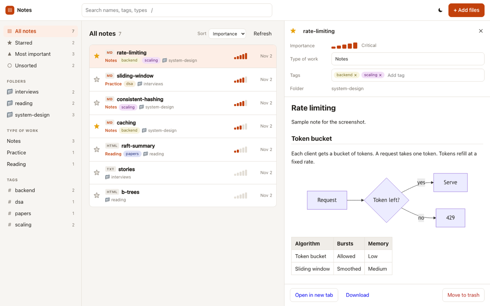

# Notes

A web app I use to read and organize my own notes: PDFs, Markdown, HTML and text files in one searchable library. It runs on my server behind a login, so there is no public demo.



The screenshot uses made-up sample files.

## What's in this repo

This repo holds the Node server (`server/server.mjs`) and the built web app (`dist/`). It does not hold the frontend source.

The frontend started as [pdf-shelf](https://github.com/rohan-ahire1/pdf-shelf), but that repo is an earlier version that reads from Google Drive. The current frontend, which talks to this server, isn't published yet, so `dist/` is the only copy of it here.

## What the app does

Notes can be starred, given an importance from 1 to 5, filed in folders and tagged. Smart views show all notes, starred ones, the most important ones and anything unsorted, and `/` jumps to search. The viewers cover PDFs through pdf.js, Markdown with Mermaid diagrams, and HTML notes in a sandbox. There are light and dark themes.

The built frontend uses React 18, pdfjs-dist, marked with DOMPurify, and Mermaid.

## How the server works

`server/server.mjs` is 350 lines of Node with no dependencies.

Notes are plain files in a folder, so a file copied in with `scp` just shows up. Stars, tags and the rest go in one sidecar file, `.shelf.json`, keyed by relative path. Writes to it go through a promise chain and land with a temp file and a rename, so two quick edits can't overwrite each other or leave a half-written file. Entries for files that have disappeared get pruned the next time the list loads.

A few details are there because the app serves files that could contain anything:

- HTML notes are served with a `sandbox` Content Security Policy, so a script inside a note can't reach the API.
- Paths that are hidden or that point outside the notes folder are refused.
- Requests that change data and come from another origin are blocked.
- Deleting moves a file to `.trash/`.
- Uploads stream to a temp file and then get renamed, with a 200 MB cap.

The server has no login of its own and listens on `127.0.0.1` by default. In production, Caddy sits in front of it and handles login.

| Route | What it does |
|---|---|
| `GET /api/notes` | List notes with their metadata |
| `PATCH /api/notes` | Update a note's metadata |
| `DELETE /api/notes` | Move a note to `.trash/` |
| `POST /api/upload` | Upload a file |
| `GET /raw/<path>` | Serve a note's file |

## Run it locally

You need Node. Point `NOTES_DIR` at a folder of files:

```bash
git clone https://github.com/rohan-ahire1/notes.git
```

```bash
cd notes
```

```bash
NOTES_DIR=~/my-notes node server/server.mjs
```

Open <http://127.0.0.1:8798>.

| Variable | Default | Meaning |
|---|---|---|
| `PORT` | `8798` | Port to listen on |
| `HOST` | `127.0.0.1` | Address to listen on |
| `NOTES_DIR` | `~/notes` | Folder of notes |
| `STATIC_DIR` | `../dist` | Built web app, relative to the server file |

## Project layout

```text
server/server.mjs   the API and file server
dist/               the built web app
docs/readme/        the image in this README
```
